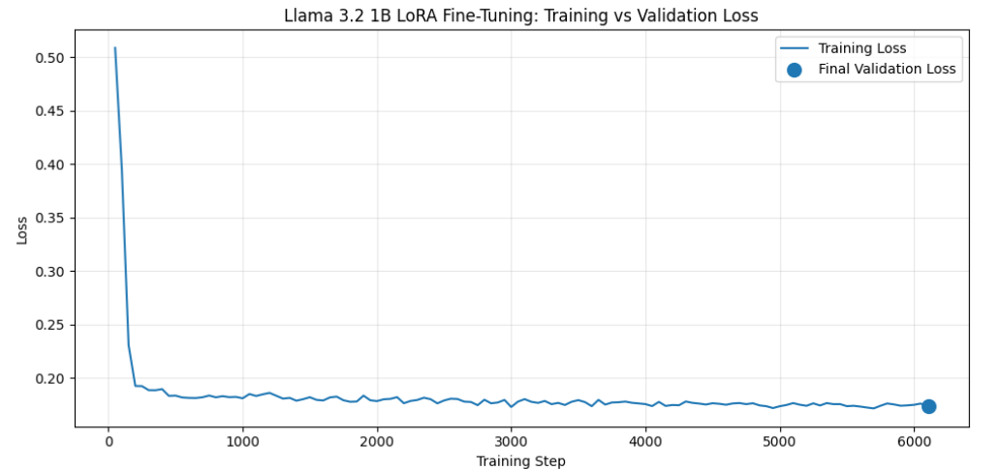

# Llama 3.2 1B LoRA Fine-Tuning for Robotics QA

Parameter-efficient fine-tuning of Meta Llama 3.2 1B Instruct on a robotics question-answering dataset using LoRA.

## Results

- Total parameters: 1,239,222,272
- Trainable LoRA parameters: 3,407,872 (0.275%)
- Final training loss: 0.173438
- Final validation loss: 0.173505
- Training steps: 6,106

## Training Curve

## Repository Structure

- `notebooks/llama3_lora_finetuning.ipynb` — end-to-end fine-tuning notebook
- `results/training_validation_loss.png` — training/validation loss visualization
- `requirements.txt` — Python dependencies

## Notes

The pretrained base model weights and local checkpoints are intentionally excluded from Git. Hugging Face authentication secrets should never be committed.
